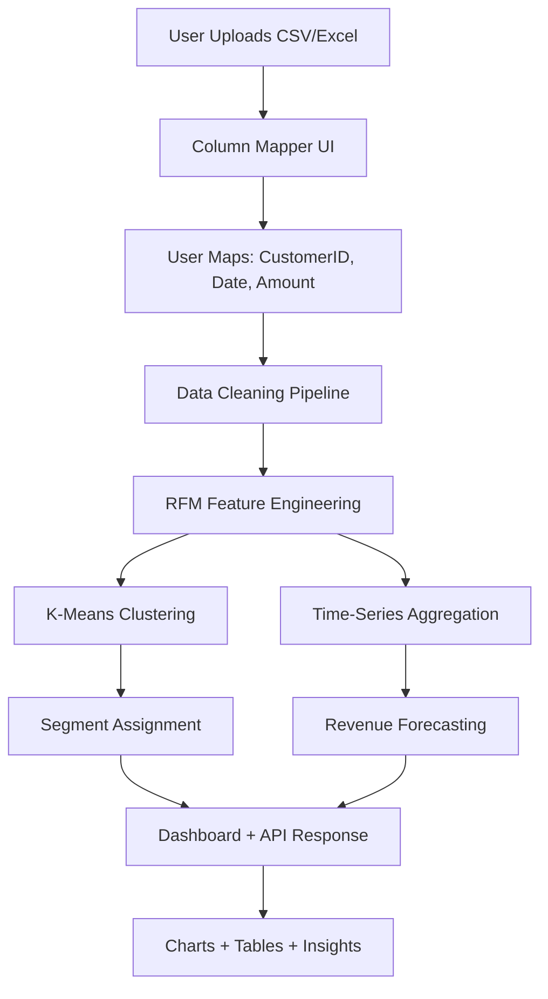

# Business Inspector — Full Implementation Guide

## What You're Building

A **universal transaction data analyzer**. User uploads ANY transaction CSV/Excel → maps 3 columns → gets:

1. **RFM Analysis** — Recency, Frequency, Monetary scores per customer
2. **Customer Segments** — K-Means clustering (Champions, Loyal, At Risk, Dormant, etc.)
3. **Revenue Forecasting** — 1-month ahead predictions for revenue, customer count, profit
4. **Churn Signal** — derived from clusters (dormant/at-risk = likely churned), no separate model needed

> [!IMPORTANT]
> **No pre-trained model.** Everything trains fresh on the uploaded data. That's why it works universally.

---

## Architecture Overview



**Data Flow in Plain English:**
1. User uploads a file (any transaction data)
2. User tells the app which column is "customer", "date", and "amount" (via dropdowns)
3. App cleans the data (removes nulls, bad rows, converts types)
4. App computes RFM per customer from the clean data
5. K-Means clusters customers into segments
6. App aggregates revenue by month and forecasts next month
7. Dashboard shows everything: segments, forecasts, churn risks, charts

---

## Tech Stack

| Layer | Tool | Why |
|-------|------|-----|
| Language | Python 3.11+ | ML ecosystem |
| Data | pandas, numpy | Data wrangling |
| Clustering | scikit-learn (KMeans, StandardScaler) | Industry standard |
| Forecasting | statsmodels (ExponentialSmoothing or ARIMA) | Lightweight, no extra deps |
| Backend | Flask + Blueprints | You already have it set up |
| Frontend | Jinja2 + Chart.js | Interactive charts, no React needed |
| Database | PostgreSQL (optional, for saving results) | Already in your docker-compose |
| Containers | Docker + docker-compose | Already configured |
| Deploy | Render + Neon | Already planned |

---

## Project File Structure

```
Business_Inspector/
├── app/
│   ├── __init__.py              # Flask app factory
│   ├── config/
│   │   └── config.py            # Environment config
│   ├── routes/
│   │   ├── auth_home.py         # Homepage route
│   │   ├── auth_inspect.py      # Upload + analyze routes (REWRITE)
│   │   └── extensions.py        # Shared imports
│   ├── templates/
│   │   ├── base.html            # Base layout
│   │   └── auth/
│   │       ├── homepage.html    # Landing page
│   │       ├── inspect.html     # Upload + column mapping page (REWRITE)
│   │       └── dashboard.html   # Results dashboard (NEW)
│   └── static/
│       ├── css/
│       │   ├── homepage.css
│       │   ├── inspect.css      # (REWRITE)
│       │   └── dashboard.css    # (NEW)
│       └── js/
│           ├── inspect.js       # Upload + mapping logic (REWRITE)
│           └── dashboard.js     # Chart rendering (NEW)
│
├── ml/
│   ├── __init__.py
│   ├── config.py                # Column aliases, segment maps
│   ├── preprocessing.py         # Universal data cleaner (REWRITE)
│   ├── model_factory.py         # Orchestrator: runs full pipeline (REWRITE)
│   ├── rfm/
│   │   ├── __init__.py
│   │   ├── rfm_engine.py        # RFM computation (KEEP, fix column refs)
│   │   └── config.py            # Segment map, feature lists (KEEP)
│   ├── cluster/
│   │   ├── __init__.py
│   │   ├── cluster_engine.py    # K-Means + Elbow method (NEW)
│   │   └── segment_mapper.py    # Map cluster IDs → human labels (NEW)
│   └── forecast/
│       ├── __init__.py
│       └── forecast_engine.py   # Time-series forecasting (NEW)
│
├── datasets/                    # Demo datasets for testing
├── uploads/                     # User-uploaded files (gitignored)
├── Dockerfile
├── docker-compose.yml
├── requirements.txt
└── run.py
```

---

## Component-by-Component Build Guide

### Component 1: Column Mapper (The Key Innovation)

**Problem:** Every dataset has different column names.
**Solution:** After upload, show all column names as dropdowns. User picks which column is "Customer ID", "Date", and "Amount".

**Frontend (inspect.html + inspect.js):**
```
Step 1: User uploads CSV
Step 2: Backend reads first 5 rows, sends column names back
Step 3: Frontend shows 3 dropdowns:
        - "Which column is Customer ID?" → [dropdown of all columns]
        - "Which column is the Date?"    → [dropdown of all columns]
        - "Which column is the Amount?"  → [dropdown of all columns]
Step 4: User selects, clicks "Analyze"
Step 5: Backend receives: {customer_col: "CustNo", date_col: "OrderDate", amount_col: "Total"}
```

**Backend route (auth_inspect.py):**
```python
@inspect_auth.route('/inspect/get_columns', methods=['POST'])
def get_columns():
    """After file upload, return column names + preview rows."""
    file_path = session.get('uploaded_file_path')
    df = pd.read_csv(file_path, nrows=5)
    return jsonify({
        'columns': df.columns.tolist(),
        'preview': df.head().to_dict(orient='records')
    })

@inspect_auth.route('/inspect/analyse', methods=['POST'])
def analyse():
    """Run full pipeline with user-mapped columns."""
    data = request.get_json()
    column_mapping = {
        'customer_col': data['customer_col'],
        'date_col': data['date_col'],
        'amount_col': data['amount_col']
    }
    file_path = session.get('uploaded_file_path')
    results = model_factory.run_pipeline(file_path, column_mapping)
    return jsonify(results)
```

**Why this matters:** This is what makes the tool universal. No hardcoded column names. The user tells you what's what.

---

### Component 2: Data Cleaning Pipeline

**File:** `ml/preprocessing.py`

**What it does:**
1. Rename user-selected columns to internal standard names (`CustomerID`, `Date`, `Amount`)
2. Drop rows with missing CustomerID or Date
3. Convert Date column to datetime
4. Remove negative amounts (returns/cancellations)
5. Add computed columns if needed (e.g., TotalPrice = Quantity × Price)

```python
class DataCleaner:
    def __init__(self, column_mapping: dict):
        """
        column_mapping = {
            'customer_col': 'CustNo',    # user's column name
            'date_col': 'OrderDate',
            'amount_col': 'Total'
        }
        """
        self.mapping = column_mapping

    def clean(self, df: pd.DataFrame) -> pd.DataFrame:
        # Step 1: Rename to standard internal names
        df = df.rename(columns={
            self.mapping['customer_col']: 'CustomerID',
            self.mapping['date_col']: 'Date',
            self.mapping['amount_col']: 'Amount'
        })

        # Step 2: Drop rows missing critical columns
        df = df.dropna(subset=['CustomerID', 'Date', 'Amount'])

        # Step 3: Convert date
        df['Date'] = pd.to_datetime(df['Date'], errors='coerce')
        df = df.dropna(subset=['Date'])

        # Step 4: Remove negative/zero amounts
        df = df[df['Amount'] > 0]

        # Step 5: Ensure CustomerID is string
        df['CustomerID'] = df['CustomerID'].astype(str)

        return df
```

**Key Design Decision:** After this step, every dataset — regardless of original column names — has `CustomerID`, `Date`, `Amount`. All downstream code only uses these 3 names.

---

### Component 3: RFM Engine (You Already Have This — Needs Fixes)

**File:** `ml/rfm/rfm_engine.py`

**What it does:** Computes per-customer Recency, Frequency, Monetary from cleaned data.

**Fixes needed in your existing code:**
- Change hardcoded column `'Customer ID'` → `'CustomerID'` (match cleaned output)
- Change `'InvoiceDate'` → `'Date'`
- Change `'TotalPrice'` → `'Amount'`
- The `rfm_score()` method is good — keep the quintile scoring (1-5)
- The `assign_segments()` method is good — keep the regex segment mapping

**After fixes, the flow:**
```
Clean DataFrame (CustomerID, Date, Amount)
    → rfm_engine.calculate_rfm() → Recency, Frequency, Monetary per customer
    → rfm_engine.rfm_score()     → RecencyScore, FrequencyScore, MonetaryScore (1-5)
    → rfm_engine.assign_segments() → Segment label per customer
```

---

### Component 4: K-Means Clustering Engine (NEW)

**File:** `ml/cluster/cluster_engine.py`

**What it does:** Takes RFM values, finds optimal clusters, assigns each customer.

```python
from sklearn.cluster import KMeans
from sklearn.preprocessing import StandardScaler
import numpy as np

class ClusterEngine:
    def __init__(self, max_k=8):
        self.max_k = max_k
        self.scaler = StandardScaler()

    def find_optimal_k(self, rfm_values: np.ndarray) -> int:
        """Elbow method: find the best number of clusters."""
        inertias = []
        K_range = range(2, self.max_k + 1)

        for k in K_range:
            km = KMeans(n_clusters=k, random_state=42, n_init=10)
            km.fit(rfm_values)
            inertias.append(km.inertia_)

        # Find elbow: biggest drop in inertia
        diffs = [inertias[i] - inertias[i+1] for i in range(len(inertias)-1)]
        optimal_k = list(K_range)[np.argmax(diffs) + 1]

        return max(optimal_k, 3)  # minimum 3 clusters

    def fit_predict(self, rfm_df: pd.DataFrame) -> pd.DataFrame:
        """Scale RFM values, cluster, return df with cluster labels."""
        features = rfm_df[['Recency', 'Frequency', 'Monetary']].values
        scaled = self.scaler.fit_transform(features)

        optimal_k = self.find_optimal_k(scaled)
        self.model = KMeans(n_clusters=optimal_k, random_state=42, n_init=10)
        rfm_df['Cluster'] = self.model.fit_predict(scaled)

        return rfm_df
```

**Why both RFM scoring AND K-Means?**
- RFM scoring (quintiles) = rule-based segmentation (your existing `assign_segments`)
- K-Means = data-driven segmentation (finds natural groupings)
- Show BOTH on the dashboard — this demonstrates you understand the difference between rule-based and ML-based approaches. Strong portfolio signal.

---

### Component 5: Segment Mapper (NEW)

**File:** `ml/cluster/segment_mapper.py`

**What it does:** Converts raw cluster numbers (0, 1, 2, 3) into business-friendly names based on cluster characteristics.

```python
class SegmentMapper:
    def map_clusters(self, rfm_df: pd.DataFrame) -> pd.DataFrame:
        """
        Analyze each cluster's average RFM and assign a label.
        High R + High F + High M = Champions
        Low R + Low F + Low M = Dormant (= Churn Risk)
        """
        cluster_profiles = rfm_df.groupby('Cluster').agg({
            'Recency': 'mean',
            'Frequency': 'mean',
            'Monetary': 'mean'
        })

        # Rank clusters by composite score
        # Low recency = good (bought recently), High freq/monetary = good
        max_recency = cluster_profiles['Recency'].max()
        cluster_profiles['Score'] = (
            (max_recency - cluster_profiles['Recency']) / max_recency * 0.33 +
            cluster_profiles['Frequency'] / cluster_profiles['Frequency'].max() * 0.33 +
            cluster_profiles['Monetary'] / cluster_profiles['Monetary'].max() * 0.34
        )

        # Sort by score and assign labels
        sorted_clusters = cluster_profiles.sort_values('Score')
        n = len(sorted_clusters)
        labels = self._get_labels(n)

        label_map = {}
        for i, cluster_id in enumerate(sorted_clusters.index):
            label_map[cluster_id] = labels[i]

        rfm_df['ClusterLabel'] = rfm_df['Cluster'].map(label_map)

        # Churn signal: bottom clusters = high churn risk
        churn_clusters = sorted_clusters.index[:max(1, n // 3)].tolist()
        rfm_df['ChurnRisk'] = rfm_df['Cluster'].isin(churn_clusters)

        return rfm_df

    def _get_labels(self, n):
        all_labels = ['Dormant', 'At Risk', 'Need Attention',
                      'About to Sleep', 'Promising', 'Potential Loyalists',
                      'Loyal', 'Champions']
        # Pick evenly spaced labels based on cluster count
        step = max(1, len(all_labels) // n)
        return all_labels[:n*step:step][:n]
```

**This is your churn signal** — no separate churn model needed. Customers in the bottom clusters (low frequency, low monetary, high recency) = likely churned.

---

### Component 6: Forecast Engine (NEW)

**File:** `ml/forecast/forecast_engine.py`

**What it does:** Aggregates transactions by month, then forecasts next month's revenue, customer count, and profit.

```python
from statsmodels.tsa.holtwinters import ExponentialSmoothing
import pandas as pd
import numpy as np

class ForecastEngine:
    def __init__(self, periods=1):
        self.periods = periods  # how many months ahead

    def aggregate_monthly(self, df: pd.DataFrame) -> pd.DataFrame:
        """Group transactions by month."""
        df['YearMonth'] = df['Date'].dt.to_period('M')

        monthly = df.groupby('YearMonth').agg(
            Revenue=('Amount', 'sum'),
            Customers=('CustomerID', 'nunique'),
            Transactions=('Amount', 'count'),
            AvgOrderValue=('Amount', 'mean')
        ).reset_index()

        monthly['YearMonth'] = monthly['YearMonth'].dt.to_timestamp()
        monthly = monthly.sort_values('YearMonth')
        return monthly

    def forecast(self, monthly: pd.DataFrame) -> dict:
        """Forecast next month for each metric."""
        results = {}
        metrics = ['Revenue', 'Customers', 'Transactions']

        for metric in metrics:
            series = monthly[metric].values

            if len(series) < 4:
                # Not enough data — use simple average
                pred = float(np.mean(series))
            else:
                try:
                    model = ExponentialSmoothing(
                        series,
                        trend='add',
                        seasonal=None,
                        initialization_method='estimated'
                    )
                    fitted = model.fit(optimized=True)
                    pred = float(fitted.forecast(self.periods)[0])
                except Exception:
                    pred = float(np.mean(series[-3:]))  # fallback: last 3 months avg

            current = float(series[-1])
            change_pct = ((pred - current) / current * 100) if current != 0 else 0

            results[metric] = {
                'current': round(current, 2),
                'forecast': round(max(pred, 0), 2),  # no negative forecasts
                'change_pct': round(change_pct, 1)
            }

        return results

    def get_monthly_trend(self, monthly: pd.DataFrame) -> list:
        """Return monthly data as list of dicts for Chart.js."""
        return monthly.to_dict(orient='records')
```

**Why ExponentialSmoothing over Prophet/ARIMA:**
- Prophet requires `pip install prophet` (huge dependency, slow install, C++ compiler needed)
- ARIMA needs careful parameter tuning (p, d, q)
- ExponentialSmoothing is in statsmodels (already lightweight), works well for monthly business data, and requires zero tuning

---

### Component 7: Model Factory / Pipeline Orchestrator (REWRITE)

**File:** `ml/model_factory.py`

**What it does:** Connects all ML components into one pipeline call.

```python
from ml.preprocessing import DataCleaner
from ml.rfm.rfm_engine import RFMEngine
from ml.rfm.config import SEGMENT_MAP, assign_segment_features, rfm_summary_features
from ml.cluster.cluster_engine import ClusterEngine
from ml.cluster.segment_mapper import SegmentMapper
from ml.forecast.forecast_engine import ForecastEngine
from ml.rfm.data_loader import DataLoader
import logging

class ModelFactory:
    @staticmethod
    def run_pipeline(file_path: str, column_mapping: dict) -> dict:
        """Full pipeline: Load → Clean → RFM → Cluster → Forecast → Return results."""

        # 1. Load
        loader = DataLoader(file_path)
        raw_df = loader.load_data()
        logging.info(f"Loaded {len(raw_df)} rows")

        # 2. Clean (using user's column mapping)
        cleaner = DataCleaner(column_mapping)
        clean_df = cleaner.clean(raw_df)
        logging.info(f"After cleaning: {len(clean_df)} rows")

        # 3. RFM
        rfm_engine = RFMEngine(SEGMENT_MAP, assign_segment_features, rfm_summary_features)
        rfm_values = rfm_engine.calculate_rfm(clean_df)
        rfm_scored = rfm_engine.rfm_score(rfm_values)
        rfm_segments = rfm_engine.assign_segments(rfm_scored)
        rfm_summary = rfm_engine.rfm_summary(rfm_segments)

        # 4. Cluster (K-Means on RFM values)
        cluster_engine = ClusterEngine()
        clustered = cluster_engine.fit_predict(rfm_values.copy())

        # 5. Map clusters to business labels + churn signal
        mapper = SegmentMapper()
        labeled = mapper.map_clusters(clustered)

        # 6. Forecast
        forecast_engine = ForecastEngine()
        monthly = forecast_engine.aggregate_monthly(clean_df)
        forecasts = forecast_engine.forecast(monthly)
        monthly_trend = forecast_engine.get_monthly_trend(monthly)

        # 7. Package results
        return {
            'status': 'success',
            'dataset_info': {
                'total_rows': len(raw_df),
                'clean_rows': len(clean_df),
                'unique_customers': clean_df['CustomerID'].nunique(),
                'date_range': {
                    'start': str(clean_df['Date'].min().date()),
                    'end': str(clean_df['Date'].max().date())
                }
            },
            'rfm_summary': rfm_summary.to_dict(orient='records'),
            'rfm_segments': rfm_segments.to_dict(orient='records'),
            'clusters': {
                'n_clusters': labeled['Cluster'].nunique(),
                'distribution': labeled['ClusterLabel'].value_counts().to_dict(),
                'churn_risk_count': int(labeled['ChurnRisk'].sum()),
                'churn_risk_pct': round(labeled['ChurnRisk'].mean() * 100, 1)
            },
            'forecasts': forecasts,
            'monthly_trend': monthly_trend
        }
```

---

### Component 8: Dashboard (NEW)

**File:** `app/templates/auth/dashboard.html` + `app/static/js/dashboard.js`

The dashboard should display these sections:

**Section 1: Dataset Overview Card**
- Total transactions, unique customers, date range
- Displayed as metric cards at the top

**Section 2: Revenue Forecast**
- Line chart (Chart.js) showing monthly revenue trend + forecasted next month
- Cards showing: Current Revenue, Forecasted Revenue, % Change
- Same for Customer Count and Transactions

**Section 3: Customer Segments (RFM Rule-Based)**
- Pie chart showing segment distribution (Champions, Loyal, At Risk, etc.)
- Table with segment stats (mean recency, frequency, monetary per segment)

**Section 4: Customer Segments (K-Means ML-Based)**
- Bar chart showing cluster distribution
- Highlight churn-risk clusters in red

**Section 5: Churn Risk Summary**
- Big number: "X% of customers are at risk of churning"
- List of customers flagged as churn risk (sortable table)

**Chart.js example for revenue trend:**
```javascript
const ctx = document.getElementById('revenueTrendChart').getContext('2d');
new Chart(ctx, {
    type: 'line',
    data: {
        labels: monthlyTrend.map(d => d.YearMonth),
        datasets: [{
            label: 'Monthly Revenue',
            data: monthlyTrend.map(d => d.Revenue),
            borderColor: '#6366f1',
            tension: 0.3,
            fill: true,
            backgroundColor: 'rgba(99, 102, 241, 0.1)'
        }]
    }
});
```

---

## Day-by-Day Build Plan

| Day | What to Build | Files Touched |
|-----|--------------|---------------|
| **1** | Fix `preprocessing.py` — universal DataCleaner with column mapping | `ml/preprocessing.py` |
| **2** | Fix `rfm_engine.py` — use standard column names (CustomerID, Date, Amount) | `ml/rfm/rfm_engine.py` |
| **3** | Build `cluster_engine.py` + `segment_mapper.py` — K-Means + elbow + labeling | `ml/cluster/` |
| **4** | Build `forecast_engine.py` — monthly aggregation + ExponentialSmoothing | `ml/forecast/` |
| **5** | Build `model_factory.py` — wire all components together, test with Online Retail II | `ml/model_factory.py` |
| **6** | Rewrite `auth_inspect.py` — add `/get_columns` route, column mapping flow | `app/routes/auth_inspect.py` |
| **7** | Rewrite `inspect.html` + `inspect.js` — upload UI + column mapping dropdowns | `app/templates/`, `app/static/js/` |
| **8** | Build `dashboard.html` + `dashboard.js` — Chart.js charts, metric cards, tables | `app/templates/`, `app/static/` |
| **9** | Style everything — CSS for inspect + dashboard pages | `app/static/css/` |
| **10** | Test with a DIFFERENT dataset (not Online Retail II) to prove universality, then Docker + deploy | All |

---

## Dependencies to Add

```
# Add to requirements.txt
statsmodels==0.14.1
```

Everything else (scikit-learn, pandas, numpy, matplotlib) is already in your requirements.

---

## How to Test Universality

After building, test with at least 2 different datasets:

**Dataset 1:** Online Retail II (you already have it)
- customer_col = `Customer ID`
- date_col = `InvoiceDate`
- amount_col = `Price` (or compute Quantity × Price)

**Dataset 2:** Any Kaggle transaction dataset with different column names
- For example: [E-Commerce Data](https://www.kaggle.com/datasets/carrie1/ecommerce-data)
- Or even create a fake 100-row CSV with columns named `client_no`, `purchase_date`, `total_spent`

If both work through the same pipeline with zero code changes → you've proven universality.

---

## What Makes This a Strong Portfolio Project

1. **Solves a real problem** — "I can analyze ANY company's transaction data, not just one dataset"
2. **Shows ML depth** — RFM (feature engineering) + K-Means (unsupervised) + Forecasting (time-series) = 3 different ML disciplines
3. **Shows engineering maturity** — OOP, modular pipeline, column mapping, error handling, Docker, deployment
4. **Shows you understand ML limitations** — you don't pretend one model works everywhere; you built a pipeline that adapts
5. **Visual output** — dashboards with real charts, not just numbers in a terminal

> [!TIP]
> When presenting this project, lead with: *"Every company's data looks different. Instead of training one model, I built a pipeline that works on any transaction dataset — the user just maps 3 columns and gets instant customer intelligence."*

---

## Open Questions

> [!IMPORTANT]
> 1. **Do you want user authentication (login)?** Your current setup has JWT config but no actual auth flow. For a portfolio demo, you might skip auth and keep it open.
> 2. **Do you want to save results to PostgreSQL?** Or is it fine to just compute and display in-memory (simpler, no DB needed for the ML part)?
> 3. **Should the dashboard be a separate page or same page as upload?** I'd recommend: upload/map on `/inspect`, results on `/inspect/dashboard`.
